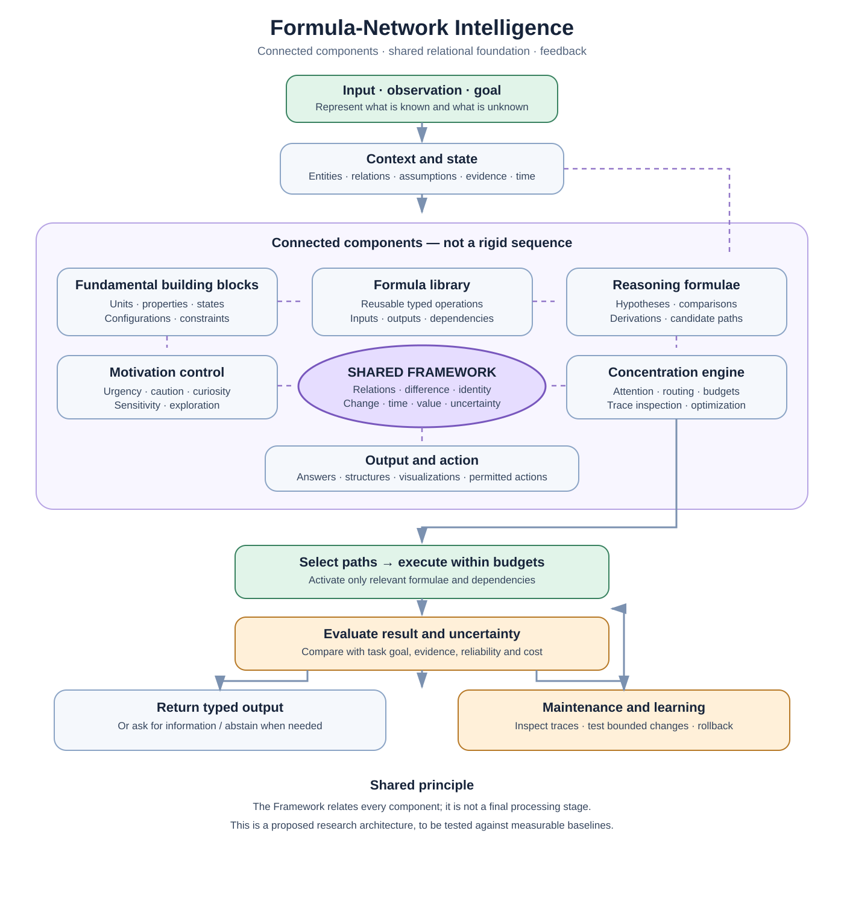
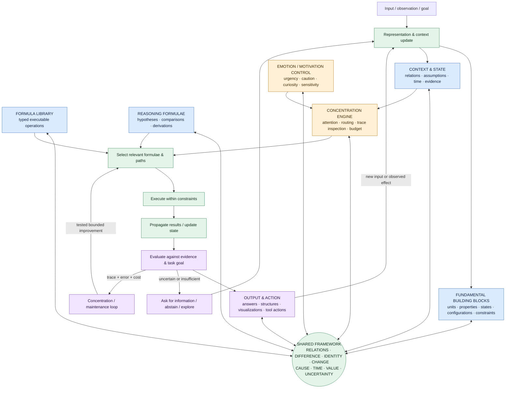
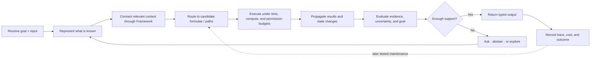
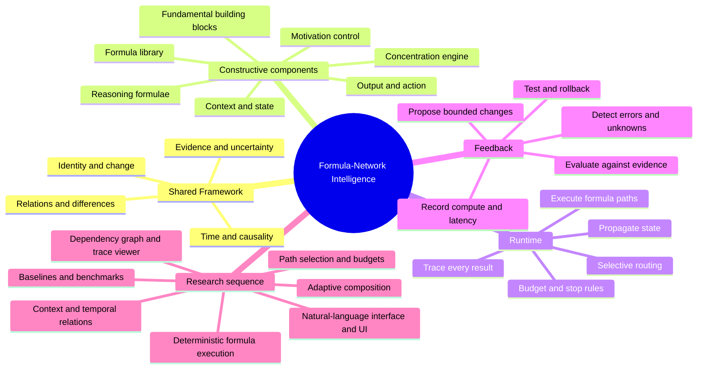

# Formula-Network Intelligence Architecture

**Status:** Proposed architecture; research hypothesis, not a demonstrated intelligent system.

## Core idea

Build one general execution environment from independently executable formulae and connected processing paths. A request activates relevant units; outputs may create relations, update state or probability, and activate dependent units. Small and large tasks use the same underlying engineering structure, while computational depth varies with task difficulty.

The intended foundation is not a conventional language generator. Natural language is a learned interface layer that maps human expressions to internal representations and renders verified results. The system's primary internal work may involve quantities, entities, relations, conditions, hypotheses, state changes, and executable operations.

## Proposed layers — visual overview

[Open the architecture diagram directly](formula-network-intelligence.svg).

### Component cards

Fundamental building blocks

Construct and represent distinguishable units, properties, states, configurations, constraints, and candidate primitives across physical, chemical, mathematical, symbolic, abstract, and hypothetical domains. Generated candidates still need domain validation.

Formula library

Reusable executable operations with typed inputs and outputs, preconditions, dependencies, metadata, and traceable effects.

Reasoning formulae

Operations for forming hypotheses, chaining rules, comparing alternatives, deriving relationships, and constructing paths.

Context and state

Relevant task information, entities, relationships, assumptions, constraints, evidence, time, and current state.

Emotion / motivation control

Functional control variables such as urgency, caution, sensitivity, curiosity, persistence, and creative exploration.

Concentration engine

Supervises routing and resource allocation; inspects traces, identifies errors and redundant work, and proposes bounded optimizations for testing.

Output and action

Returns typed results such as numbers, structures, natural language, visualizations, tool calls, or robot actions.

The **Framework is shared across all components**, not a final stage. The runtime activates only the units and paths relevant to the current task. The cards are a compact visual index; the detailed execution, maintenance, constraints, and evaluation specifications follow below.

## Cross-cutting capabilities

- **Shared execution runtime:** schedules formulae, moves typed outputs, tracks dependencies, enforces budgets, detects cycles, and records traces.
- **Routing and filters:** select which formulae and paths activate; the whole library need not run for every task.
- **Prediction and evaluation:** predict outcomes, compare results against evidence or requirements, represent uncertainty, and diagnose failures.
- **Learning and adaptation:** improve routing and reusable paths, propose formula or connection changes, and evaluate whether changes generalize.
- **Memory and context organization:** place information near its closest relevant category/relationships; distinguish source, observation, inference, hypothesis, and speculation.
- **Time awareness:** timestamp events, information acquisition, state changes, formula executions, and validity intervals; represent ordering and expiry explicitly.
- **Specialist modules:** role-play, domain skills, legal information, creativity/invention, multimodal sensing, robotics, and external model/API orchestration.
- **User customization:** configurable formulae, filters, output formats, layer settings, paths, preferences, UI controls, and feature integrations.

## Formula metadata contract

Each formula should declare at least:

- stable ID and version;
- input/output schema and units;
- preconditions and postconditions;
- dependencies and activation rules;
- source/provenance and evidence basis;
- measured reliability and uncertainty by task class;
- computational cost and resource limits;
- creation/update timestamps and validity period where applicable;
- execution history, known failure modes, and rollback version;
- permissions and side effects.

Metadata informs routing and context, but should not be treated as proof that a formula is correct.

## Execution loop

1. Receive input and context.
2. Construct or update an internal typed representation.
3. Route to candidate formulae and paths.
4. Execute eligible units within a computation budget.
5. Propagate results and update shared state or probabilities.
6. Evaluate outputs and uncertainty against task requirements/evidence.
7. Return a typed result or request more information.
8. Record trace and feedback for later optimization.

## Concentration / maintenance loop

1. Inspect execution traces, test results, code versions, and resource profiles.
2. Identify recurring errors, redundant paths, poor routing, stale context, or expensive operations.
3. Propose one bounded change at a time.
4. Evaluate on saved benchmarks and held-out cases.
5. Accept only if quality, reliability, and resource metrics meet explicit thresholds.
6. Preserve rollback and provenance; never treat an unverified self-modification as established knowledge.

This process may run during sleep-like/idle mode, but it does not imply that continuous full retraining is needed.

## Design constraints

- One core runtime can execute many kinds of formulae; formula count alone should not determine per-request cost.
- Selective activation, branch pruning, caching, and reusable paths are key efficiency hypotheses.
- Cycles need termination rules, iteration bounds, or tested convergence criteria.
- Deterministic formula execution should be separate from uncertain routing, inference, and natural-language rendering.
- Changes to code, tools, memory, and real-world actions need permission boundaries, audit traces, tests, and rollback.
- A user-provided input such as a bare number is insufficient to choose among arbitrary formulae without a default, context, or learned routing policy.
- Formula interaction alone does not establish intelligence. Generalization, correction, sample efficiency, reliability, and cost must be measured.

## Evaluation targets

- Accuracy/success on unseen tasks;
- number of observations needed to acquire reusable paths;
- error detection and recovery rate;
- calibration and appropriate abstention;
- compute and latency per successful task;
- number of active units and explored paths;
- regression rate after maintenance changes;
- transfer to a related but different problem.

## Research sequence

1. Typed formula registry and deterministic execution.
2. Directed dependency graph, filters, and trace viewer.
3. Context store with relationships and explicit time metadata.
4. Simple path selection and stopping/budget rules.
5. Benchmarked evaluation and error categories.
6. Concentration engine for analysis and safe optimization proposals.
7. Adaptive path selection and formula composition.
8. Natural-language interface, then specialist tools and user-customizable UI.

## Related repository areas

- `FORMULAE/` — individual operations and formal expressions.
- `CONCEPTS/` — representation, uncertainty, time, identity, and context concepts.
- `THINKING_PROCESSES/` — reasoning-path generation, routing, evaluation, and correction.
- `LEARNING/` — adaptation methods and lessons.
- `EXPERIMENTS/` — empirical tests and benchmarks.
- `PROBLEMS/` and `QUESTIONS/` — unresolved issues and falsifiable questions.
- `DECISIONS/` — choices made and their reasons.

## Evidence status

All architecture details here are proposals. They should be treated as hypotheses until implemented and compared with baselines under controlled tests.

---

## Visual architecture — whole-system map

This is the architecture at a glance. The **Framework is the shared relational foundation**, not an extra stage that sits after the other layers. The runtime activates only the units and paths relevant to the current task.

## Component cards — responsibilities and connections

These are connected components, not isolated sequential layers. Each card states its role, exchanges, and questions the implementation must answer.

| Component | Role | Connects to / exchanges | Questions to test |
|---|---|---|---|
| **Fundamental building blocks** | Construct or represent units, properties, states, configurations, constraints, and candidate primitives across domains | Shared Framework; input representation; formulae | How is a candidate represented, combined, transformed, and validated? |
| **Formula library** | Reusable operations with typed inputs, outputs, preconditions, dependencies, and traceable effects | Framework; reasoning formulae; runtime | How are formulae selected, composed, reused, and stopped? |
| **Reasoning formulae** | Build and compare hypotheses, derive relations, and construct candidate paths | Formula library; context/state; evaluation | Which steps are supported by evidence, and which are only hypotheses? |
| **Context and state** | Hold relevant entities, relations, assumptions, observations, history, and time-dependent changes | Every active component through the Framework | What remains relevant, what changed, and what is unknown? |
| **Emotion / motivation control** | Functional control signals for urgency, caution, curiosity, sensitivity, and exploration | Concentration engine; routing and budgets | Do these signals change priorities predictably and help task outcomes? |
| **Concentration engine** | Allocate attention and computation, inspect traces, detect waste, and propose bounded improvements | Formula paths; runtime; evaluation; maintenance loop | Which paths deserve resources, and when should execution stop? |
| **Output and action** | Return typed results, explanations, structures, visualizations, or permitted actions | Evaluation; external environment; new input | Does the result satisfy the goal, and can its basis be inspected? |
| **Shared Framework** | The common relational foundation connecting all components; not a separate stage | Relations and updates across every component | Can new relations change what the system can represent or do? |
| **Evaluation and evidence** | Compare outputs with goals, observations, constraints, uncertainty, and baselines | Runtime traces; output; maintenance | Is the result correct, calibrated, efficient, and generalizable? |
| **Maintenance / learning loop** | Inspect failures and costs; propose one bounded change; test before acceptance | Traces; benchmarks; routing; reusable formulae | Does the change improve held-out results without regressions? |

## Execution path — one request

## Mind map — research and implementation

## How to read the visual

- **Solid arrows** show the proposed request/execution/feedback flow; two-way links to the Framework show shared relational exchange.
- **The Framework is central and cross-cutting**: it relates components rather than acting as a one-time processing step.
- **The cards are a reading interface**; the runtime is a connected network whose active path depends on the task.
- This is a research proposal. The diagram expresses the intended architecture, not proof that these capabilities already work.
