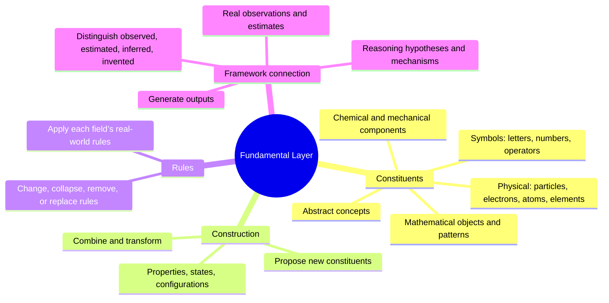

# Fundamental Building Blocks

**Status:** Conceptual proposal; not yet experimentally validated.
**Role:** First layer in the Formula-Network Intelligence Architecture.

## Purpose

Establish and expand the fundamental units, distinctions, properties, states, and configurations from which the system can represent, construct, inspect, and creatively explore things across domains—including constructions that were not explicitly predefined.

This layer is not fundamentally a character recognizer or a fixed dictionary of known objects. It is the foundation for construction itself. Human-readable symbols, alphabets, numbers, and notation are one way to supply defined components and express results; they do not define the limits of the layer.

## Scope

The layer should support representations/building blocks for:

- **Physical:** matter, energy, fields, spatial configurations, and physical systems.
- **Chemical:** elements, atoms, bonds, molecules, compounds, and reaction participants.
- **Mathematical and quantitative:** quantities, numbers, dimensions, variables, mathematical objects, and operations.
- **Symbolic and representational:** alphabets, characters, digits, notation, diagrams, codes, signals, and other encodings.
- **Patterns and structures:** repetition, sequences, symmetry, configurations, and reusable arrangements.
- **Abstract and conceptual:** distinctions, properties, qualities, identities, and abstractions.
- **Imaginary and hypothetical:** invented entities, fictional worlds, counterfactuals, and speculative constructions.
- **Relations, processes, and change:** connections, interactions, transformations, and state changes where needed to define a construction.

These are overlapping domains and candidate categories, not a mandate to create one sub-layer for each.

## First-layer mind map

## Important distinctions

- A primitive is relative to a representational system; do not assume a universal smallest unit has already been discovered.
- A unit, its properties, its relations, and a configuration containing it are not interchangeable.
- A symbol represents something; it is not necessarily the thing represented.
- A construction consistent with an imagined rule system is not thereby physically possible or real.
- A generated candidate is not validated knowledge. Physical and chemical claims require appropriate constraints and evidence.
- Introduce new primitives in response to a demonstrated representational need, not simply to expand an inventory.

## Relationship to other architecture parts

- **Formulae:** organize, combine, and operate on building blocks.
- **Reasoning Formulae:** derive, compare, test, and revise candidate constructions.
- **Context:** supplies applicable assumptions, constraints, interpretations, and state.
- **Framework:** provides shared relational structure across units, properties, and configurations; it is not a sequential stage.
- **Output:** renders constructions as human-readable or machine-usable results.

These boundaries remain provisional and should be refined through examples and experiments.

## Human-readable input remains one application

The earlier idea of pasting characters, alphabets, numbers, symbols, and patterns remains useful as a defined, human-understandable construction path. It is a specific application of the broader foundation, not its definition. A chemical structure, for example, should not be reduced to its formula string: elements, bonds, arrangement, and constraints are separate representational aspects.

## Questions and tests

1. What minimal distinctions support units, properties, relations, configurations, and encodings?
2. When should the system compose existing primitives, and when should it propose a new primitive?
3. How can identity persist across different encodings?
4. How can domain constraints be represented without hard-coding every domain?
5. How should physical possibility, mathematical validity, fictional consistency, and speculation be distinguished?
6. What evidence is required before a generated construction can be treated as reliable?
7. What belongs here versus Formulae, Reasoning Formulae, Context, or Framework?
8. What test demonstrates novel construction rather than retrieval or recombination?
9. How will coverage, novelty, validity, resource cost, and failure modes be measured?

### Initial experiment

Compare a symbolic expression, a chemical structure, a mathematical object, and an imaginary entity. For each, record units, properties, relations/configuration, constraints, provenance/status, and human-readable rendering. Identify shared representation needs and genuine domain differences before proposing sub-layers.

## Evidence status

This is a conceptual proposal. Representation alone does not demonstrate creativity, reasoning, or physical validity; each capability requires its own test.
